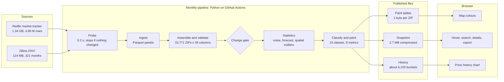

<p align="center">
    
</p>

<p align="center">
   <a href="https://jasperwchen.github.io/Domapus/" target="_blank" rel="noopener noreferrer"> 
    
  </a>
</p>

<p align="center">
  
  
  
</p>

**Domapus** is a website that visualizes U.S. housing market data at the ZIP-code level.  

---

## Features

### Main Dashboard
<p align="center">Visualize median price, inventory, and sales trends nationwide. Hover over a ZIP code to show value.</p>
<p align="center"></p>
<br>

### Granular ZIP Details
<p align="center">Click on a ZIP code to access detailed market data.</p>
<p align="center"></p>
<br>

### Comparative Analysis
<p align="center">Compare two ZIP codes side-by-side to evaluate relative market performance across all available metrics.</p>
<p align="center"></p>
<br>

### Export
<p align="center">Generate report-ready maps with customizations.</p>
<p align="center"></p>
<br>

### Embed
Put the live map on your own page.

```html
<iframe src="https://jasperwchen.github.io/Domapus/?embed=1&metric=zhvi&lat=33.75&lng=-84.39&zoom=8" width="100%" height="520" style="border:0" loading="lazy" title="Domapus housing map"></iframe>
```


---

## How it works

A Python pipeline turns two monthly source files into a few static files, the site reads those files directly. The map's colours come from a compact paint table for fast initial load.


---

## Quick Start

1. **Clone the repository**

   ```bash
   git clone https://github.com/jasperwchen/Domapus.git
   cd Domapus
   ```

2. **Install dependencies**

   ```bash
   npm install
   ```

3. **Restore history and enable repository hooks**

   ```bash
   npm run data:sync
   git config core.hooksPath .githooks
   ```

   History files are not stored in git. The sync command restores the release named
   by the manifest; a production build rejects missing or mismatched history.
   The post-merge hook repeats this sync after pulls. The pre-commit hook regenerates
   the file tree and checks workflow YAML; it requires the Python development dependencies
   described below.

4. **Start the development server**

   ```bash
   npm run dev
   ```

5. **Open your browser**

   Navigate to `http://localhost:3677`.

---

## Tech Stack

| Layer          | Technologies                                       |
| :------------- | :------------------------------------------------- |
| Frontend       | React 18, TypeScript, Vite                         |
| UI             | Tailwind CSS, Radix UI, shadcn/ui, Lucide          |
| Map            | MapLibre GL JS, PMTiles, Turf                      |
| Export         | Canvas 2D, jsPDF                                   |
| Data Pipeline  | Python 3.14, NumPy, SciPy, PyArrow                 |
| Deployment     | GitHub Pages, GitHub Actions                       |

---

## Metrics Overview

Eight metrics colour the map. The rest appear in the detail panel and the comparison view for
the selected ZIP.

| Metric | Source | Choropleth map |
| :--- | :--- | :---: |
| **Zillow Home Value Index** | Zillow | Yes |
| **Median Sale Price** | Redfin | Yes |
| **Median Price per Sq Ft** | Redfin | Yes |
| **Homes Sold** | Redfin | Yes |
| **Active Listings** | Redfin | Yes |
| **Median Days on Market** | Redfin | Yes |
| **% Sold Above List** | Redfin | Yes |
| **Months of Supply** | Redfin | Yes |
| Median New Listing Price | Redfin | No |
| Median Listing Price per Sq Ft | Redfin | No |
| New Listings | Redfin | No |
| Pending Sales | Redfin | No |
| Inventory | Redfin | No |
| Sale-to-List Ratio | Redfin | No |
| % Off Market in 2 Weeks | Redfin | No |

---
Data sources: [Redfin Data Center](https://www.redfin.com/news/data-center/), [Zillow Research](https://www.zillow.com/research/data/).

See the [Methodology](https://jasperwchen.github.io/Domapus/methodology) page for details on color scaling, sample-size thresholds, and the one-year forecast model.

---

## Data Pipeline

A Python pipeline runs monthly via GitHub Actions. It downloads the latest Redfin and Zillow files, computes all statistics, and writes a set of static files that the site consumes at runtime. Releases are rejected if month-over-month changes exceed thresholds that would indicate a broken upstream file.

Remote downloads are checked against the initial source probe. For an offline run,
`--skip-probe` requires both `--redfin-csv` and `--zhvi-csv` local files.

To run the pipeline locally (requires Python 3.14):

```bash
pip install -r requirements-dev.txt   # or requirements.txt for the pipeline alone
python -m pipeline
```

---

## Project Structure

| Path            | Contents                                          |
| :-------------- | :------------------------------------------------ |
| `src/`          | React application                                 |
| `pipeline/`     | Monthly data pipeline                             |
| `public/data/`  | Published data files used by site                 |
| `scripts/`      | Build, palette, and geometry maintenance scripts  |
| `tests/`        | Pipeline tests                                    |
| `bench/`        | Performance benchmarks                            |

See full file listings in [tree.txt](tree.txt).

---

## Limitations

Data reflects monthly aggregates published by Redfin and Zillow, with a typical lag of several weeks. Redfin only reports ZIP codes with market activity, so rural ZIPs with few sales may show "N/A". ZIPs with low transaction volume produce noisy medians; these are flagged as low-confidence and excluded from color-scale calibration, though they remain visible on the map.

---

## Contributing

1. Fork the repository and create a feature branch.
2. Enable the repo hooks: `git config core.hooksPath .githooks`.
3. Verify your changes before opening a PR:

   ```bash
   npm run lint
   npm test
   npm run build
   pytest   # only if pipeline/ was modified
   ```

4. Push your branch and open a Pull Request.

---

## About the Name

**Domapus** combines **dom**, meaning house, **map**, and **us**, meaning the United States.

---

## License

Licensed under the Apache License 2.0. See [LICENSE.md](LICENSE.md).

---

## Contact and Support

Report bugs or request features via [GitHub Issues](https://github.com/jasperwchen/Domapus/issues), or contact the maintainer at [jasperc.wk@gmail.com](mailto:jasperc.wk@gmail.com).

If you find Domapus useful, consider supporting its development:

[](https://buymeacoffee.com/JasperC)

---

<div align="center">
   <strong>Built by <a href="https://www.linkedin.com/in/jasperwchen">Wei Jasper Chen</a></strong>
   <br><small>Distributed under the <a href="https://github.com/jasperwchen/Domapus?tab=Apache-2.0-1-ov-file">Apache License 2.0</a></small>
</div>
